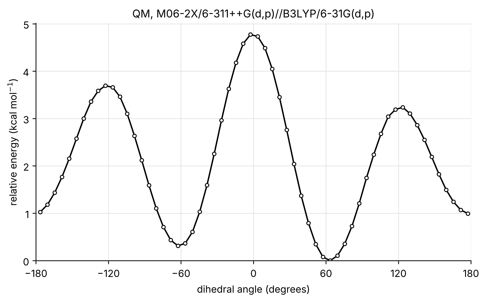
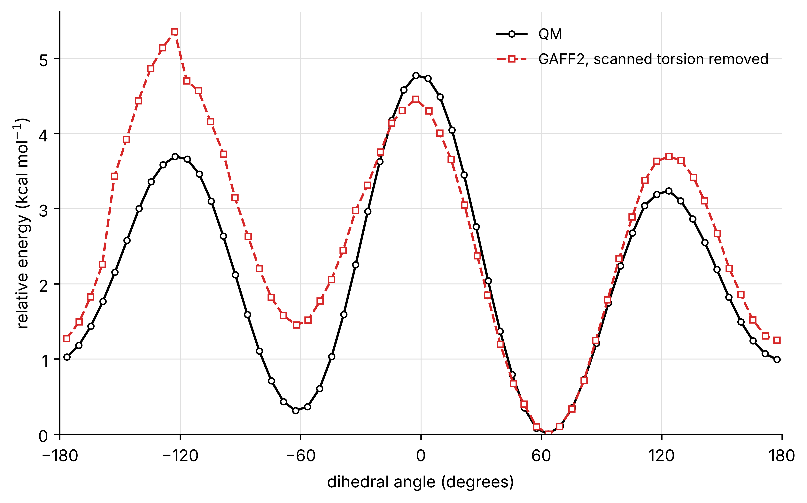
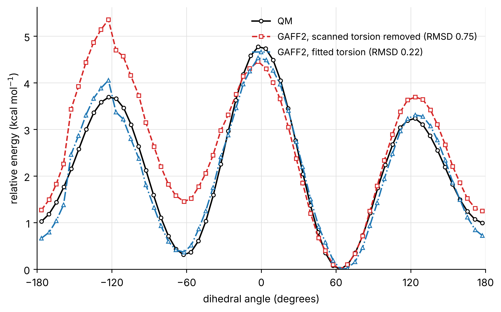

<b>A general force field will reproduce most of a molecule unremarkably well and then get one torsion badly wrong.</b> This page refits a single GAFF2 dihedral against a quantum mechanical torsional profile, using 1,3-propanediol as the example, and puts the new parameters into an AMBER topology.

The route is the usual one: scan the torsion with QM, reproduce the same geometries with the force field after deleting the term being parameterised, fit a cosine series to the difference, and check that the corrected force field reproduces the QM profile. It needs Gaussian, GROMACS, AmberTools and <a href="https://parmed.github.io/ParmEd/" target="_blank">parmed</a>; numpy, scipy and matplotlib are needed by the Python scripts.

Everything shown below is in the repository, including the scan output, the single-point calculations and the profiles, so each step can be repeated without running the expensive parts again.

| Script | What it does |
| --- | --- |
| [gaussian_scan_geoms.py](https://arvpinto.github.io/GAFF2_dihedral_parameterization/scan_qm/gaussian_scan_geoms.py) | Pulls the optimised geometries out of a Gaussian relaxed scan and writes the single-point inputs and the GROMACS structures |
| [gaussian_dihedral.py](https://arvpinto.github.io/GAFF2_dihedral_parameterization/scan_qm/single_point/gaussian_dihedral.py) | Builds the QM profile from a set of Gaussian outputs |
| [amb2gmx.py](https://arvpinto.github.io/GAFF2_dihedral_parameterization/scan_mm/amb2gmx.py) | Converts the AMBER topology and coordinates to GROMACS format |
| [gromacs_dihedral.py](https://arvpinto.github.io/GAFF2_dihedral_parameterization/scan_mm/single_point/gromacs_dihedral.py) | Builds the MM profile from a set of GROMACS single-point runs |
| [least_squares_fit.py](https://arvpinto.github.io/GAFF2_dihedral_parameterization/dihedral_fit/least_squares_fit.py) | Fits the cosine series and writes the topology lines |
| [plot_profiles.py](https://arvpinto.github.io/GAFF2_dihedral_parameterization/dihedral_fit/plot_profiles.py) | Draws the profiles |
| [make_parmed_input.py](https://arvpinto.github.io/GAFF2_dihedral_parameterization/dihedrals_add_top/make_parmed_input.py) | Writes the parmed commands that swap the old term for the new ones |

Every script takes <code>--help</code>.

---

 
<h2> 
 <b>I - Torsional profile with QM </b> 
</h2>

 

The molecule is built in GaussView and the torsion is driven with the ModRedundant section of a relaxed scan. Here the scanned dihedral is 10-1-4-7 (O1-C1-C2-C3) and it is turned through a full circle in 60 steps of 6 degrees:

<pre style="color: white; background-color: black;">
# opt=modredundant b3lyp/6-31g(d,p) scf=tight

Title Card Required

0 1
 C                  1.39817300    0.52720100    0.22441400
 H                  2.01440700    1.35294300   -0.16438900
 H                  1.44317500    0.57662300    1.32520700
 C                 -0.04224600    0.70264600   -0.23892700
 H                 -0.06319300    0.64168000   -1.33558100
 H                 -0.39046500    1.70533500    0.03570800
 C                 -1.00011300   -0.33618100    0.34929500
 H                 -0.65273900   -1.34722800    0.09797700
 H                 -1.00776200   -0.25692900    1.44251900
 O                  1.86718200   -0.73237700   -0.25133700
 H                  2.76112600   -0.86758100    0.08668800
 O                 -2.34813900   -0.12614100   -0.05961100
 H                 -2.39178000   -0.29869800   -1.00922800

10 1 4 7 S 60 6.0
12 7 4 1 F

</pre>

The second line of the ModRedundant section freezes the equivalent torsion on the other side of the molecule, 12-7-4-1. Without it the optimiser is free to relax that second torsion as the first one turns, and the profile picks up sudden drops that have nothing to do with the coordinate being scanned. The same restraint has to be imposed later on the MM side, otherwise the two profiles describe different things.

Two rules decide whether the scan is usable at all: start from a structure that is a minimum on the potential energy surface, and freeze every other soft degree of freedom that could jump during the scan.

The optimised geometry of each point is then extracted and recomputed at a higher level of theory. The relaxed scan only has to produce sensible geometries; the energies that go into the fit come from the single points, so this is where the better method belongs:

<pre style="color: white; background-color: black;">
# One XYZ file with all the converged geometries, plus one Gaussian input per point
python gaussian_scan_geoms.py propanediol_scan.log -o scan_geoms.xyz \
    --write-inputs --prefix sp --route "#p M062X/6-311++G(d,p)" --charge 0 --mult 1

# Run them
for i in sp_*.com; do g09 "$i"; done
</pre>

The <a href="https://github.com/tomaszborowski/gaussian2xyz" target="_blank">gaussian2xyz</a> script of Tomasz Borowski and Zuzanna Wojdyla does the same extraction and also handles IRC and ONIOM output, which the script here does not.

The profile is then read off the outputs. The script measures the dihedral on each final geometry rather than trusting the order of the files, and reports the energies relative to the lowest point of the set:

<pre style="color: white; background-color: black;">
python gaussian_dihedral.py 10 1 4 7 sp_*.log -o qm_scan.dat
</pre>

This is the point at which to check the sign. A dihedral angle is signed, and two formulations that look alike can differ by a minus sign, which is easy to write and hard to notice: the profile still looks sensible, only mirrored. Gaussian prints the value it used in the Optimized Parameters table of the scan output, so comparing one point costs nothing:

<pre style="color: white; background-color: black;">
grep "D(10,1,4,7)" propanediol_scan.log | head -1
! D9    D(10,1,4,7)            63.5166         Scan                            !

awk '$1 > 63 && $1 < 64' qm_scan.dat
      63.517               0.000000
      63.517               0.001004
</pre>

The same angle appears twice because a scan of 60 steps of 6 degrees closes the circle and recomputes its starting point; the two energies agree to 0.001 kcal/mol, which is a free check that the scan did not drift. The fitting script drops the repeat.

The angles that come out here become the targets of the MM restraints in Part II. If they carry the wrong sign, every MM point is minimised at the opposite torsion to the QM point it is paired with, and the fit is quietly wrong.

    

The profile spans 4.8 kcal/mol. The global minimum is the gauche well at +64 degrees, the second gauche well at -62 degrees sits 0.3 kcal/mol above it, and the two barriers that separate them are 3.7 and 3.2 kcal/mol high. The intramolecular hydrogen bond between the two hydroxyl groups makes the profile distinctly asymmetric. That asymmetry matters later: it is the reason a term with a free phase fits this torsion much better than the symmetric terms a general force field is built from.

M06-2X/6-311++G(d,p) is used here as an example. For production work a method known to describe conformational energies well, such as MP2/cc-pVTZ or a double-hybrid, is the better choice, and the level used for the scan itself can stay cheap.

 
<h2> 
 <b>II - Torsional profile with MM </b> 
</h2>

 

The molecule is first parameterised with GAFF2. The charges are derived with ABCG2 from the same geometry used to start the scan:

<pre style="color: white; background-color: black;">
antechamber -fi gout -i propanediol.log -fo mol2 -o propanediol.mol2 -nc 0 -c abcg2 -pf y -at gaff2
antechamber -fi mol2 -i propanediol.mol2 -fo ac -o propanediol.ac -pf y
prepgen -i propanediol.ac -o propanediol.prepin
parmchk2 -i propanediol.prepin -f mol2 -o propanediol.frcmod -s gaff2

tleap
>source leaprc.gaff2
>loadamberprep propanediol.prepin
>mol = loadmol2 propanediol.mol2
>saveoff mol propanediol.lib
>quit

tleap
>source leaprc.gaff2
>loadamberparams propanediol.frcmod
>loadoff propanediol.lib
>loadamberprep propanediol.prepin
>mol = loadmol2 propanediol.mol2
>saveAmberParm mol propanediol.prmtop propanediol.rst7
>quit
</pre>

The torsion of interest is the one that GAFF2 assigns to the atom type sequence oh-c3-c3-c3. In the topology built here it is a single term with a height of 0.21 kcal/mol, multiplicity 3 and a phase of 0 degrees, and it is what the rest of this page replaces. It is worth reading the value out of the topology rather than taking it from the parameter file, since it depends on which version of GAFF2 is loaded:

<pre style="color: white; background-color: black;">
echo "printDihedrals @10 @1 @4 @7" | parmed propanediol.prmtop
</pre>

Coordinates and parameters are then converted to the GROMACS format and given a box:

<pre style="color: white; background-color: black;">
python amb2gmx.py propanediol.prmtop propanediol.rst7
gmx editconf -f propanediol_converted.gro -bt triclinic -d 1.0 -o propanediol_converted.gro
</pre>

To drive the torsion in GROMACS, a restraint section is added to the topology after the parameters. The placeholder is replaced by the angle of each point of the scan, and the second restraint reproduces the torsion that Gaussian kept frozen:

<pre style="color: white; background-color: black;">
#ifdef DIHRES
[ dihedral_restraints ]
10 1 4 7 1 DIHE_VALUE 0 10000
12 7 4 1 1 177.95895 0 10000
#endif
</pre>

Each point is then minimised with its torsion held in place, using <a href="https://arvpinto.github.io/GAFF2_dihedral_parameterization/scan_mm/min_steep_restr.mdp" target="_blank">min_steep_restr.mdp</a>, which switches the block on with <code>define = -DDIHRES</code>. Each minimisation starts from the QM geometry of that point rather than from a common structure, which is what keeps the two profiles describing the same conformer, so the starting structures are written out first:

<pre style="color: white; background-color: black;">
# one .gro per scan point, named after the dihedral it holds
python gaussian_scan_geoms.py propanediol_scan.log --drop-last \
    --write-gro --gro-template propanediol_converted.gro --dihedral 10 1 4 7 \
    --gro-prefix qm --outdir .

for g in qm_*.gro; do
    i=$(basename "$g" .gro | sed 's/^qm_//')
    sed 's/DIHE_VALUE/'"$i"'/g' propanediol_converted.top > dihe.top
    gmx grompp -f min_steep_restr.mdp -c "$g" -p dihe.top -o min_"$i".tpr
    gmx mdrun -deffnm min_"$i" -c dihe_"$i".gro
done
</pre>

Minimising every point from the same starting structure is the usual shortcut, and it is where this kind of scan goes wrong: the hydroxyl groups settle into different orientations at different angles, and the MM profile picks up steps of several tenths of a kcal/mol that the torsion term is then asked to absorb.

These minimisations give the MM geometries, not the energies that the fit needs. What the fit needs is the energy of those same geometries with the torsion being parameterised <i>removed</i> from the force field, so that the fitted term is not asked to account for anything that the other terms already cover (see <a href="https://pubs.acs.org/doi/10.1021/acs.jpca.0c10845" target="_blank">J. Phys. Chem. A 2021, 125, 1, 519-529</a>). Deleting the 10-1-4-7 line from the <code>[ dihedrals ]</code> section and running single points on the structures just produced gives that profile, with <a href="https://arvpinto.github.io/GAFF2_dihedral_parameterization/scan_mm/single_point/min_steep_sp.mdp" target="_blank">min_steep_sp.mdp</a> (<code>nsteps = 0</code>, and no <code>define</code>, so the restraints stay off and contribute nothing to the energy):

<pre style="color: white; background-color: black;">
for i in dihe_*.gro; do
   gmx grompp -f min_steep_sp.mdp -c "$i" -p propanediol_converted.top -o "${i%.gro}".tpr
   gmx mdrun -deffnm "${i%.gro}"
done

python gromacs_dihedral.py dihe_*.log -o mm_scan.dat
</pre>

The angle of each point is read from the file name, which carries the QM value, so the two profiles end up on exactly the same grid and the fit needs no interpolation. The restraint is not infinitely stiff and the minimised structure settles a fraction of a degree away from its target; <code>--atoms 10 1 4 7 --coords .</code> measures the angle on each structure instead, which is worth doing when the restraint is loose or the profile is steep, at the cost of a grid that no longer matches the QM one exactly.

    

The gap between the two curves is the target of the fit. It is largest around -56 degrees, where the force field without its torsion term is 1.1 kcal/mol too high.

 
<h2> 
 <b>III - Fitting the torsion term </b> 
</h2>

 

Both GROMACS and AMBER write a proper dihedral as a sum of cosines,

E(&phi;) = &sum;n Kn [1 + cos(n&phi; - &delta;n)]

so fitting means finding the heights Kn and the phases &delta;n that bring the MM profile onto the QM one. <a href="https://arvpinto.github.io/GAFF2_dihedral_parameterization/dihedral_fit/least_squares_fit.py" target="_blank">least_squares_fit.py</a> solves that by linear least squares in a cosine and sine basis, converts the result to heights and phases, and can refine it with a non-linear step:

<pre style="color: white; background-color: black;">
python least_squares_fit.py --qm qm_scan.dat --mm mm_scan.dat --nmax 3 \
    --indices 10 1 4 7 --types oh c3 c3 c3 --out dihedral.itp

60 points, 3 term(s), phases free
RMSD 0.5546 kJ/mol (0.1326 kcal/mol), largest deviation 1.1059 kJ/mol
constant offset C0 = -5.6000 kJ/mol (not a force field term)

   n      K(kJ/mol)    K(kcal/mol)     delta(deg)
   1       2.294474       0.548392        61.2126
   2       1.435342       0.343055        28.1296
   3       0.247865       0.059241        -4.0432
</pre>

The script prints the heights in both units and writes the <code>[ dihedraltypes ]</code> and <code>[ dihedrals ]</code> lines for GROMACS together with the parmed commands for AMBER, which saves having to convert anything by hand. The constant offset C0 is the part of the difference that no cosine can describe; it shifts the whole curve and cancels in any relative energy, so it is reported and then discarded.

How many terms to use is the one real decision here. <code>--scan</code> shows what each extra multiplicity buys:

<pre style="color: white; background-color: black;">
python least_squares_fit.py --qm qm_scan.dat --mm mm_scan.dat --scan 6

 nmax   RMSD(kJ/mol)    max dev
    1         1.1698     2.3110
    2         0.5817     1.0775
    3         0.5546     1.1059
    4         0.1844     0.4847
    5         0.1781     0.4404
    6         0.1691     0.4486
</pre>

Three terms are used below. The fourth would cut the RMSD by two thirds, but a multiplicity of 4 has no obvious physical reading for a torsion about a single bond between two tetrahedral carbons, and a term fitted to one molecule at one level of theory is being asked to work in environments it never saw. Reproducing the training profile to the last tenth of a kJ/mol is rarely what makes a torsion transferable.

A second choice worth making deliberately is whether the phases are free. <code>--phases symmetric</code> restricts them to 0 or 180 degrees, which keeps the term symmetric about &phi; = 0, as the terms of a general force field almost always are. For this torsion that constraint costs a lot, with the RMSD rising from 0.55 to 1.60 kJ/mol, because the intramolecular hydrogen bond makes the real profile asymmetric. A free phase is the right choice here, but it does encode a specific conformational preference, which is a reason to be careful about carrying the term over to a fragment where that hydrogen bond cannot form.

The three <code>[ dihedrals ]</code> lines are then put back into the topology, in the place where the original term was deleted, and the single points of Part II are run again:

<pre style="color: white; background-color: black;">
for i in dihe_*.gro; do
   gmx grompp -f min_steep_sp.mdp -c "$i" -p propanediol_converted.top -o "${i%.gro}".tpr
   gmx mdrun -deffnm "${i%.gro}"
done

python gromacs_dihedral.py dihe_*.log -o mm_corrected.dat

python plot_profiles.py qm_scan.dat mm_scan.dat mm_corrected.dat \
    --labels "QM" "GAFF2, scanned torsion removed" "GAFF2, fitted torsion" \
    --rmsd-against 1 -o dihedral_qm_mm_corr.png
</pre>

    

The corrected force field reproduces the QM profile with an RMSD of 0.14 kcal/mol, against 0.62 kcal/mol for the profile without the term, and the largest deviation falls from 1.12 to 0.26 kcal/mol. Both minima and the ordering of the two barriers are recovered; what is left is a slight overestimation of the barrier near -120 degrees, which is the part of the curve that three cosines cannot reach.

Running the single points again with the fitted term in place is not optional. It is the only step that shows whether the parameters actually do in the topology what the fit says they should.

 
<h2> 
 <b>IV - Adding the parameters to a topology </b> 
</h2>

 

Torsion parameters are usually derived on a small fragment and then used in something much larger. In this part the fitted term is carried over to a box of 1,3-propanediol molecules, which stands in for the complex topology that the fragment was meant to represent.

The box is built by replicating the single molecule and parameterised in the same way:

<pre style="color: white; background-color: black;">
echo -e "box x 5 y 5 z 5 alpha 90 beta 90 gamma 90 \n replicatecell out propanediol_system.mol2 all " | cpptraj propanediol.mol2 -y propanediol.mol2

tleap
>source leaprc.gaff2
>loadamberparams propanediol.frcmod
>loadoff propanediol.lib
>loadamberprep propanediol.prepin
>mol = loadmol2 propanediol_system.mol2
>saveAmberParm mol propanediol_system.prmtop propanediol_system.rst7
>quit
</pre>

Every dihedral that carries the parameterised atom types now has to lose its old term and gain the new ones. <a href="https://arvpinto.github.io/GAFF2_dihedral_parameterization/dihedrals_add_top/make_parmed_input.py" target="_blank">make_parmed_input.py</a> finds them in the topology, converts the heights from kJ/mol to the kcal/mol that AMBER uses, and writes the parmed input:

<pre style="color: white; background-color: black;">
python make_parmed_input.py propanediol_system.prmtop --types oh c3 c3 c3 \
    --itp ../dihedral_fit/dihedral.itp -o dihedrals_parmed.in \
    --parmout propanediol_system_newdihe.prmtop

54 dihedral(s) x 3 term(s) -> dihedrals_parmed.in
  n=1  K=0.548392 kcal/mol  delta=61.2126 deg
  n=2  K=0.343055 kcal/mol  delta=28.1296 deg
  n=3  K=0.059241 kcal/mol  delta=-4.0432 deg

parmed propanediol_system.prmtop -i dihedrals_parmed.in
</pre>

The input it writes is a list of <code>deleteDihedral</code> commands followed by the <code>addDihedral</code> commands, three per path, and a final <code>parmout</code>:

<pre style="color: white; background-color: black;">
deleteDihedral @10 @1 @4 @7
...
addDihedral @10 @1 @4 @7 0.548392 1 61.2126 1.2 2.0
addDihedral @10 @1 @4 @7 0.343055 2 28.1296 1.2 2.0
addDihedral @10 @1 @4 @7 0.059241 3 -4.0432 1.2 2.0
...
parmout propanediol_system_newdihe.prmtop
</pre>

Two details are easy to get wrong here. The first is the units: the fit works in kJ/mol because that is what GROMACS reports, while an AMBER topology stores kcal/mol, and a factor of 4.184 left out at this point produces a torsion barrier four times too high that nothing downstream will flag. The second is the 1-4 scaling factors, 1.2 and 2.0 for GAFF2, which <code>addDihedral</code> has to be given explicitly so the new terms scale their 1-4 interactions the way the deleted one did.

In 1,3-propanediol the atom type sequence oh-c3-c3-c3 matches two paths per molecule, one on each side, so the box of 27 molecules has 54 of them and ends up with 162 new terms. Selecting on atom types rather than on atom names is what makes that complete; a mask written on names alone would have caught only one path per molecule and left half of the torsions with their original parameters.

It is worth checking the result rather than assuming it:

<pre style="color: white; background-color: black;">
echo "printDihedrals @10 @1 @4 @7" | parmed propanediol_system_newdihe.prmtop
</pre>

 
<h2> 
 <b>V - What the result is worth </b> 
</h2>

 

A refitted torsion is a correction to one force field, derived from one molecule, in one conformational region, at one level of theory. A few consequences of that are worth keeping in view.

<b>The term absorbs whatever the rest of the force field got wrong.</b> The fit targets the difference between QM and MM, so errors in the charges, in the 1-4 scaling or in the non-bonded parameters end up inside the torsion term. Change the charge model and the fitted term is no longer the right one. This is also why the charges have to be derived before the fit and left alone afterwards.

<b>The fragment has to behave like the molecule it stands for.</b> 1,3-propanediol forms an intramolecular hydrogen bond across the scanned torsion, and the fitted term carries the imprint of it in its asymmetric phases. A fragment chosen to represent a torsion in a polymer should not have interactions that the polymer cannot have, and should not be missing those it does have.

<b>One profile is one slice of the surface.</b> Freezing the second torsion is what makes the scan interpretable, but it also means the term is fitted along a single path through a two-dimensional surface. Where two torsions are strongly coupled, fitting them one at a time has a limit that no number of cosines will get past.

<b>Check the thing you actually care about.</b> Matching the QM profile is a necessary condition, not the goal. Whether the refit changed anything that matters is answered by the conformational populations, the density or whatever property motivated the work in the first place, not by the RMSD of the fit.

